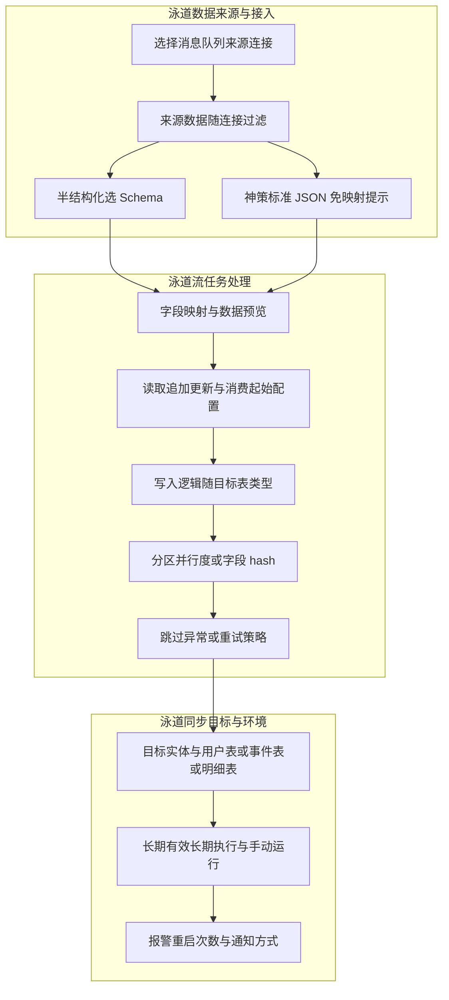
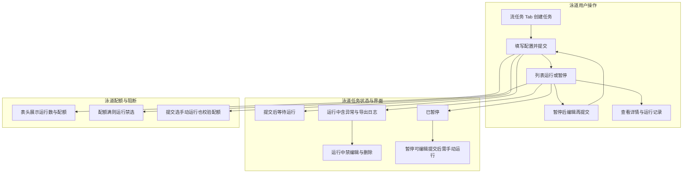
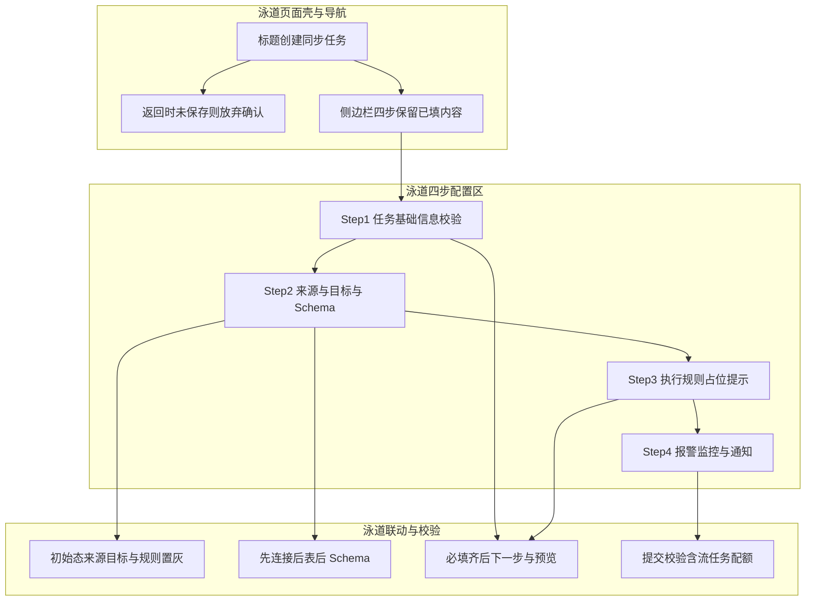

# 【SA】同步任务-流任务 PRD

- 文档状态：`已定稿`
- 所属产品：神策分析
- 所属模块：数据接入

# 基本信息

## 文档状态

| 编辑中 | 初稿完成 | 内审 | 业务方案沟通 | 需求评审 | 评审后修订 | 发布上线终版 |
| --- | --- | --- | --- | --- | --- | --- |
|  |  |  |  |  |  |  |

## 修订记录

| 版本 | 修订时间 | 修订内容 | 备注 |
| --- | --- | --- | --- |
| v1 | 2025-09-10 | 初稿完成 | 评审版本 |
| v2 | 2025-09-11 | 【增加】2.1 关于流任务现状和价值的问答 【删除】删除低优和废弃的功能点 【逻辑调整】 4.1.5任务执行规则： \" 默认消费起始\"改为 \"首次 消费起始\"，不支持编辑 【增加】4.1.5任务执行规则：交互逻辑 | 评审后修订完成 |
| v3 | 2025-09-19 | 【补充】4.3边界场景：项目开启强校验， 上报新的事件名就会导入失败。；解决方案：在高级参数中，加一个「允许在强检验下创建事件」 |  |

## 相关文档

Jira：
设计图：

# 业务场景

## 关于流任务现状和价值的问答

客户 or 数据应用场景
| 客户 or 数据应用场景 | 典型场景 | 实施方案 | 现状投入 | 产品化解决方案 |
|----|----|----|----|----|
| 一卡通、东莞证券、茶颜悦色、多点、松雷 | 对改造后端有抵触，核心顾虑：；后端不是单体应用，内部有较多微服务，不想各个服务都改 埋点对业务代码有侵入，也可能对核心交易系统性能有「细微」影响，不想冒命 | 客户定开轮询增量数据-\> JSON file -\> LogAgent或客户已有Kafka 的基础设施，定开轮询增量数据\>JSON-\>Kafka -\> Logstash -\> sensorsdata sinkplugin -\>NG | 从0搭建数据链路到稳定可用，需要；2周 | 时间可以节省到只需要；1-2 天 |
| 一卡通、东莞证券、茶颜悦色、多点、松雷 | 对改造后端有抵触，核心顾虑：；后端不是单体应用，内部有较多微服务，不想各个服务都改 埋点对业务代码有侵入，也可能对核心交易系统性能有「细微」影响，不想冒命 | 核心交易系统订单信息在 Kafka 时，若有 MA 时效性需求，可从 Kafka 读实时流，Join 表转事件导入 | 流表 Join 现在需要纯定开，依据复杂度至少是 2-4周 的投入；数据链路稳定性和质量较难保障，如果有产品能力，可以完全替代 | 可以通过产品省去数据链路环境的搭建和维护成本。；不能解决定开流表 join 的问题。 |
| 环球 | 不愿改后端；多个业务系统隔离，也没有数仓 所有对外数据交换都通过 Kafka ，需要根据变更数据还原数据表；（备注：如果还有 MA 需求，就会再雪上加霜 ） | 需要从 Kafka 变更数据还原数据表，且 Kafka 内数据还可能有重放；流表 Join 且可能是有状态的复杂业务逻辑，比如虽然是一个入园事件，但是入园次数的属性规则计算是很复杂的 | 投入了 几百人天；（本质是 MA 业务和导入揉在一起了） | 可以通过产品化解决接入kafka 的部分，配置即可；其他的流表 join 复杂业务逻辑不行 |
关于流任务现状和价值的问答
| Q | A |
| --- | --- |
| 流任务目标 | 核心目标：；构建流式数据导入的最小可用闭环； 确保数据导入过程不重、不漏，保障数据完整性； 实现任务全生效周期可运维、可监控，支撑稳定运行。 |
| 流任务可以带来什么价值 | 结合业务场景，流任务通过"产品化替代定制化"，在「 效率、稳定性、基础接入层面 」解决业务痛点，同时为复杂场景的后续迭代留足空间。；提效降本，缩短交付周期： 如 "一卡通、东莞证券" 等客户场景，原本从 0 搭建数据链路到稳定可用需 2 周，通过流任务的产品化能力，时间可压缩至 1 - 2 天；"环球" 这类投入数百人天的场景，也能通过产品化配置替代大量定制开发，大幅减少人力与时间成本。 保障数据链路稳定性与数据完整性 ： 以往定制开发的数据链路（如 "JSON 文件→Kafka→Logstash→神策插件" 等环节），稳定性和数据质量难保障；流任务通过 "数据不重不漏的导入机制 + 任务全生命周期可运维监控"，从底层确保数据传输的完整性，避免链路环节冗余导致的数据丢失、重复等问题。 简化流式数据接入，部分替代定制需求： 针对 "从 Kafka 接入数据" 的场景（如环球需还原数据表、核心交易系统订单实时导入等），流任务可通过产品化配置快速完成 Kafka 数据接入，省去手动搭建多环节链路的成本；但复杂的流表 Join（如带状态的复杂业务逻辑、MA 与导入结合的场景），当前产品化能力暂无法完全覆盖，需结合定制开发或后续迭代优化。 |

# 需求概述

## 操作主流程及界面示意

### 流程图-1：同步任务数据流（泳道）

### 流程图-2：用户操作主链路（泳道）

### 流程图-3：用户操作界面流程示例（泳道）

## 需求范围和目标

| 功能 | 说明 | 优先级 |
| --- | --- | --- |
| 4.1 配置流任务 | 4.1 基础流程 | P0 |
| 4.1 配置流任务 | 4.1.3.1；数据预览优化：配置映射后可预览前置到选择完schema可预览 | P3 |
| 4.2 管理流任务 | 4.2 基本功能 | P0 |
| 4.2 管理流任务 | 4.2.1.3 快捷筛选 | P5 本期不做删掉 |
| 4.2.1.5 列目设置 | P5 本期不做删掉 |  |
| 4.2.1.2.1 任务状态增加「schema变更」提示 | P3 本期不做删掉 |  |
| 4.2.1.2.2 任务状态「异常」lable | P1 |  |
| 5非功能性需求 | 5.1 licence；5.2 权限；5.3 操作日志；5.4 升级兼容；5.5 国际化 | P0 |

# 需求详情------功能性需求

## 配置流任务

### 创建入口

| 模块 | 功能说明 |
| --- | --- |
| 入口1 | 位置： 「数据同步-流任务」管理页面右上角。；点击效果 ：点击「创建任务」Button，于当前页面打开「创建任务」的初始配置页。 |

### 初始页面

**流创建页面布局和基本模块信息同批创建页面，表格中绿色文字为差异项**
| 模块 | 功能说明 |
| --- | --- |
| 初始页面 | 通过点击「数据同步-流任务」进入的「同步任务初始页面」包含以下内容：；页面展示及交互交互 批数据初始页面（线上逻辑） 流数据初始页面 （136需求， 绿色文字是和批页面的差异项 ） 侧边栏导航 初始状态下，导航栏包含四项内容：任务基础信息、选择同步来源和目标、配置任务执行规则、报警监控 同批，无变更 页面标题 初始名称「创建同步任务」，点击「返回 ICON」后返回「同步任务」页面，且不保存任何已配置信息。 点击 「返回 ICON」 判断所有填单项有无填充内容； 有填充内容：弹出放弃确认 窗口标题：放弃确认 窗口文案： 确定放弃创建同步任务吗？ 窗口按钮：确定放弃、继续创建 无填充内容：不弹出，直接返回 同批，无变更 任务基本信息 初始状态下，任务名称 & 描述均无内容 同批 选择数据来源和目标 数据同步来源 来源连接：默认常驻文案"请选择来源连接"。 来源数据： 默认常驻文案"请选择来源侧数据"。初始态页面下，置灰禁用 数据同步目标 目标类型：实体、已有表、新建表。初始态页面下，置灰禁用 目标数据： 默认常驻文案"请选择目标侧数据"。初始态页面下，置灰禁用 数据同步来源 来源连接：默认常驻文案"请选择来源连接" 来源数据： 默认常驻文案"请选择来源侧数据"。初始态页面下，置灰禁用 数据同步目标 目标类型：实体、已有表、新建表。初始态页面下，置灰禁用 目标数据： 默认常驻文案"请选择目标侧数据"。初始态页面下，置灰禁用 配置任务执行规则 初始态页面下，仅展示展位图片；常驻文案「请先选择同步来源和目标」 同批，无变更 报警监控 checkbox 开启警报 报警条件：复选 任务执行失败 数据同步耗时（不包含排队时间）超过 X 分钟 自设定执行时间起（包含排队时间）超过 X 分钟 通知方式： 邮件 webhook checkbox 开启警报，逻辑同批 报警条件： 近{M}分钟内，重试次数超过{N}次 通知方式： 邮件 webhook |
批初始页面逻辑，详见：5.1.1.2. 配置同步任务---任务初始态页面 【MRD】数据集成-支持表和任务分离-第二版方案#【MRD】数据集成支持表和任务分离第二版方案-配置同步任务---任务列表入口

### 任务基本信息

| 模块 | 功能说明 | 备注 |
| --- | --- | --- |
| 「线上逻辑，无调整」 基础信息 | 同批逻辑，无变更 | 交互： 文本输入框；校验：；长度检验： 任务名称不能超过 100 个字符 最多输入100个字符。输入超出限制后，输入框下方红字提示： 任务名称不能超过 100 个字符 必填检验： 清空输入框时，输入框下方红字提示：任务 名称 不可为空 字符合法性校验： 仅支持中文英文下划线，输入不合法字符，输入框下方红字提示： 默认仅支持字母、数字、下划线、中文，不支持其他字符 |
| 「线上逻辑，无调整」 描述 | 同批逻辑，无变更 | 交互：多行文本输入框；限制：；长度限制：最多输入200个字符， 输入超长时禁止输入 |

### 数据来源和目标

#### 数据同步来源

| 模块 | 功能说明 | 备注 |
| --- | --- | --- |
| 「调整」 来源连接 | 来源连接select组件 默认常驻文案"请选择来源连接" 可选范围：展示「消息队列」类型数据源的 来源连接；优化项： 「来源连接」 异常时候增加跳转入口 指定「来源连接」正常， 「来源数据」解禁， 「schema」 置灰禁用 指定「来源连接」异常， select组件飘红，下方红字提示异常后增加 「 查看详情」。 点击 查看详情 超链接新 开一个数据连接详情页。 「来源数据」 置灰禁用 |  |
| 「线上逻辑，无调整」 来源数据 | 来源数据select组件 默认常驻文案"请选择来源侧数据"。 初始态页面下，置灰禁用 "来源数据"与"来源连接"联动： 选择 "来源连接" 后，自动过滤出 与该数据连接匹配 的来源数据表 |  |
| 「新增」 Schema | 结构化数据： 若 "来源数据" 为结构化数据，不显示 Schema 配置项 // 该逻辑出现在批数据场景，此处不做过多说明 半结构化数据： 若 "来源数据" 为半结构化数据，显示 "Schema" 配置项。 // 该逻辑出现在批、流数据场景；Schema 与来源数据联动 ： 选择 "来源数据" 后，自动过滤出 与该数据表结构匹配 的 Schema：同批任务 Schema 配置项后提示文案 ： 对数据的结构与组织方式进行规范化描述 ------ 数据中包含了哪些字段、每个字段的数据类型（如整数、字符串、日期等）等信息 神策标准 JSON 格式 标识 ： //交互 以设计图为准 如果指定来源数据为 「神策标准 JSON 格式」格式，回显「神策标准 JSON 格式」标识 | 目标 ：让用户在数据同步任务中，快速选择或适配已有 schema，支撑数据读取与映射。 |

#### 数据同步目标

| 模块 | 功能说明 |
| --- | --- |
| 目标类型&目标数据 | 目标类型：实体（默认选中）；已有表、新建表：隐藏 目标数据：下拉选择框展示「用户表、事件表、明细表」类型数据表，标签表」隐藏 |

#### 字段映射

1.  **来源数据有「神策标准 JSON 格式」标识**
    1.  字段映射后，默认提示文案：「神策标准 JSON 格式」数据，无需配置同步目标和字段映射
2.  **来源数据没有「神策标准 JSON 格式」标识**
    1.  同批字段映射规则，配置规则同批，无逻辑调整

### 任务执行规则

| 信息归类 | 模块 | 功能说明 |
| --- | --- | --- |
| 执行计划 | 「调整」 生效周期&执行频率 | 生效周期：只读「长期有效」，不可修改；执行频率：只读「长期执行」，不可修改；提 交任务后立即生 效（样式用批任务手动执行，抵达生效时间后立即执行一次）；是：超过流任务配额禁选。hover提示： 无可用配额，如需继续增加，请联系客户成功经理 否：默认选中。问号提示：指定该项后，任务将不会自动启动运行；如需执行，可在任务列表页点击「运行」触发流任务启动运行 |
| 数据读取逻辑 | 「新增」 默认消费起始 | 首次 消费起始：互斥，单选；从最早位置开始消费 tips提示文案：消费者 从 Kafka 主题的最早消息位置开始消费数据 无其他配置 从最新位置开始消费 tips提示文案：消费者 只会从主题中当前最新的消息位置开始消费，忽略在此之前已经存在的消息 无其他配置 时间戳 tips提示文案： 消费者会从指定时间戳之后产生的消息开始消费 选中「时间戳」单选按钮时，触发"目标时间戳"配置区域的显示 数值输入框+毫秒 ： 仅允许输入非负整数 必填校验： 提交表单前需校验是否有值，若无则红字提示 "请输入时间戳"。 补充说明：若选择的时间早于主题最早消息时间，提交后将从主题最早消息开始消费；若选择的时间晚于主题最新消息时间， 提交后 将从最新消息开始消费 特定 偏移量 tips提示文案： 允许用户指定从 Kafka 主题的特定偏移量位置开始消费消息 偏移量 数值输入框，仅允许输入非负整数 必填校验 ：提交表单前，校验偏移量输入框是否有值。若无值，红字提示 "请输入偏移量" |
| 数据读取逻辑 | 读取逻辑 | 只读：追加更新 |
| 数据写入逻辑 | 「线上逻辑，无调整」 写入逻辑 | 匹配展示的写入逻辑同批，无逻辑调整；目标数据：主表 → 写入逻辑： 更新或插入（profile_set 逻辑） 目标数据：事件表 → 写入逻辑： 增量写入（track 逻辑） 目标数据：明细表 → 写入逻辑： 更新或插入（detail_set 逻辑） |
| 数据写入逻辑 | 分区规则 | 分区规则：单选、互斥；按并行度绑定：默认选中 按指定字段 hash：多个有序字段的hash 选中「按指定字段 hash」后，下方联动展示「hash 字段」配置区域 hash 字段选择器： 默认状态：显示「请选择」，下拉单选框 删除操作：点击已选字段右侧的「×」可移除该字段；当仅剩余 1 个字段时，「×」按钮置灰禁用（禁止删除最后一个字段）。 添加hash字段：点击「+ 添加」按钮，弹出候选字段的选择面板；选中目标字段后，依次追加显示在已选区域中。 支持拖动：支持拖动调整hash字段顺序 |
| 「新增」 是否 跳过异常数据 | 是否跳过异常数据：单选、互斥 是： 记录异常数据日志。 任务正常运行不受影响 否： 任务报异常，记录错误日志 任务进行重试流程；是否跳过异常数据，问号提示：当任务xxxx， //研发给下可能触发异常的情况 |  |
| 高级 | 「线上逻辑，无调整」 高级设置 | 非必填，默认折叠。点击【高级设置】打开配置项；并行度 数值输入框。默认文字：正整数 输入限制：输入非数值或负数自动修正为0 输入提示文案：请依据您的资源性能合理配置，实际资源不满足该配置时将导致任务运行失败，范围（0-128） 优化参数（选填），同批 |

### 报警监控

| 模块 | 功能说明 |
| --- | --- |
| 「调整」 | 开启报警 CheckBox：默认勾选，逻辑同批；勾选后，联动显示配置项 取消勾选，隐藏内容配置项；报警条件：近{M}分钟，任务重启次数大于{N}次。{M}、{N} 为数值输入框内输入的替换值；数值输入框，仅允许输入非负整数 必填校验 ：提交表单前，校验框是否有值。若无值，红字提示 "请输入"；通知方式：同批，无调整 |

### 提交

| 模块                 | 功能说明 |
| --- | --- |
| 「线上逻辑，无调整」 | 逻辑同批 |
| 「线上逻辑，无调整」 | 逻辑同批 |

## 管理流任务

### 任务列表

同步任务下按tab展示：新增流任务都在tab「流任务」下

#### 列表内容条数及配额

| 模块 | 功能说明 |
| --- | --- |
| 流任务配额显示 | 表头显示数据条数和配额，格式： 共 xx 条，流任务可用配额 {M / N} 条。；其中蓝色的M和N为替换项，M为「任务状态为运行中」的流任务总数；N为当前环境支持的总配额数 |
| 配置开关 | 默认客户只可以配置 3 条生效中（运行中）的流任务；配额通过开关上限可配；超过配额后， 运行按钮置灰禁选：hover提示：无可用配额，如需继续增加，请联系客户成功经理 |
| 初始页面 | 同批初始列表；内容区域：无数据图标+提示文案；文案： 暂无数据。您可以先点击\"创建任务\"，进行创建 |

#### 列表表头

列表默认排序：按任务ID降序排列
| 信息归类 |  | 流表头（304需求） |  |  |  |  |
| --- | --- | --- | --- | --- | --- | --- |
| 信息归类 |  | 表头 | 口径 | 是否支持筛选 | 是否支持表头排序 | 备注 |
| 任务基本信息 | 01 | 任务 ID | 由用户配置，创建/编辑任务后生成 | 任务检索框；支持用户检索「任务 ID、任务名称」 提示文案「请输入任务 ID 或 任务名称」 | 不支持 | 同批 |
| 任务基本信息 | 02 | 任务名称 | 由用户配置，创建/编辑任务后生成 | 任务检索框；支持用户检索「任务 ID、任务名称」 提示文案「请输入任务 ID 或 任务名称」 | 不支持 | 同批 |
| 任务状态 | 04 | 「调整」 任务状态 | 场景一：创建 → 提交 → （手动）运行，形成完整的 "创建 - 确认 - 运行" 链路。 场景二：暂停→编辑→提交→（手动）运行，形成完整的 "中断 - 修改 - 确认 - 恢复" 链路，符合用户对 "主动操作触发状态变更" 的认知（运行 / 暂停需明确点击按钮，而非隐含在编辑动作中）。 等待运行：创建提交，或手动编辑提交后，任务状态显示为「等待运行」 运行中：流不存在生效周期，"已生效"文案改成"运行中" 运行中 异常：流任务运行异常时候，显示异常文字及导出日志icon 已暂停：对生效运行中任务，操作「暂停」后转为该状态 | 下拉多选框 | 不支持 |  |
| 任务归属与创建信息 | 05 | 「新增」 执行频率 | 长期执行 |  |  |  |
| 任务归属与创建信息 | 07 | 创建人 | 当前任务创建人，创建任务后生成 | 搜索下拉多选框 | 不支持 | 同批 |
| 08 | 创建时间 | 当前任务创建时间，时间格式显示格式： yyyy-mm-dd hh:mm，创建任务后生成 | 时间范围选择器。粒度：天 | ✅ 支持 | 同批 |  |
|  | 「新增」 最后编辑时间 | 最后一次编辑任务时间 | ------ | ✅ 支持 |  |  |
| 任务基本信息 | 12 | 描述 | 由用户配置生，创建/编辑任务后生成 |  | 不支持 | 「新增」 |

##### 任务状态 「异常」lable

流任务运行中的任务，状态异常时候，运行中后显示「异常+下载按钮」。hover显示：导出日志。点击下载日志文件到本地

#### 操作列

| 一级 | 二级 | 说明 | 备注 |
| --- | --- | --- | --- |
| 查看任务 | ------ | 点击后于当前页 打开「查看任务」页面 |  |
| 「调整」 暂停/运行 | ------ | 可变按钮，两者间相互切换：暂停/运行点击交互统计同批 「调整」 增加流任务配额的判断逻辑，判断配额是否到上限 若流任务配额到上限（任务状态为运行中的任务 = 配额数，默认3），「运行」按钮禁选，hover提示：无可用配额，如需继续增加，请联系客户成功经理 流任务配额未到上限（任务状态为运行中的任务＜配额数，默认3），可根据状态机对任务状态进行「暂停/运行」操作 |  |
| 更多 | 「线上逻辑，无调整」 编辑 | 任务状态为「运行中」时，操作列「编辑」button和查看详情页顶部「编辑」button 禁选，hover提示：运行中的任务不支持编辑操作 任务状态为「已暂停」时，操作列「编辑」button和查看详情页顶部「编辑」button 激活可点击， 点击后于当前页面打开，进入该任务的「编辑态//编辑页面」 |  |
| 更多 | 「新增」 复制 | 「新增」 点击后在当前页面打开「复制任务名称」页面 |  |
| 「线上逻辑，无调整」 删除 | 同批删除逻辑；若任务状态为运行中：「删除」禁选，hover提示：运行中的任务不支持删除操作 若任务状态为暂停：「删除」激活，点击弹出一个二次确认弹窗 标题：确认要删除该任务吗？ button 确定：删除任务记录。同时列表页toast提示：删除成功 取消：放弃操作，关闭弹窗 |  |  |

### 查看详情

| 模块 | 功能说明 | 备注 |
| --- | --- | --- |
| 入口 | 点击「任务名称」或操作列的「查看任务」，点击后在当前页面打开任务详情页面 |  |
| 查看详情 | 查看详情，配置详情回显，以设计稿样式为准；查看态导航：任务基础信息、数据来源和目标、任务执行规则、字段映射；若任务异常存在异常原因，异常提示条吸顶显示；schema配置项：同批提示 |  |
| 顶部button | 运行记录：点击后在当前页面打开运行记录页面；复制：点击后在当前页面打开复制页面，配额判断逻辑同操作列；编辑：点击后在当前页面打开编辑页面 |  |

### 编辑态/编辑任务页面

1.  页面标题：编辑{任务名称}

2.  系统将获取到的任务配置数据填充到对应的编辑表单中展示，可编辑的参数范围见下表：
| 信息层 | 配置参数 | 是否可编辑 | 备注 |
| --- | --- | --- | --- |
| 任务基本信息 | 任务名称 | ✅可编辑 |  |
| 任务基本信息 | 描述 | ✅可编辑 |  |
| 数据来源和目标 | 数据同步来源（来源连接、来源数据、Schema） | ❌不可编辑 |  |
| 数据来源和目标 | 数据同步目标（目标类型、目标数据） | ❌不可编辑 |  |
| 字段映射（主键字段、普通字段） | ✅可编辑 |  |  |
| 任务执行规则 | 首次消费起始 | ❌不可编辑 |  |
| 任务执行规则 | 读取逻辑 | ❌不可编辑 |  |
| 写入逻辑（写入逻辑） | ❌不可编辑 |  |  |
| 写入逻辑（分区；规则；） | ✅可编辑 |  |  |
| 高级设置 | ✅可编辑 |  |  |
| 报警监控 | 开启报警 | ✅可编辑 |  |
| 报警监控 | 报警条件 | ✅可编辑 |  |
| 通知方式 | ❌不可编辑 |  |  |
3.  编辑完成点击「保存」，保存成功后，更新任务的配置信息，列表页显示 "编辑成功"toast提示。

4.  核心逻辑：编辑提交不自动触发运行，需用户手动运行。
    1.  暂停→编辑→提交→（手动）运行，形成完整的 "中断 - 修改 - 确认 - 恢复" 链路，符合用户对 "主动操作触发状态变更" 的认知（运行 / 暂停需明确点击按钮，而非隐含在编辑动作中）。

### 复制态/复制任务页面

1.  页面标题：复制{任务名称}

2.  系统将获取到的任务配置数据填充到对应的编辑表单中展示，用户可以在表单中对【全部】配置参数进行修改

3.  点击「保存」，保存成功后，生成一个新的任务ID，保存成功后，列表页显示 "复制成功"toast提示

# 需求详情------非功能性需求

## 流数据导入licence

新增流数据导入licence，默认不开启
开启后用户可见「流任务」列表

## 权限

无新增权限，查看、管理权限权限范围同批
- 【查看数据同步】权限点：可以看流任务列表、详情页、运行日志、运行记录、导出日志
- 【管理数据同步】权限点：可以看流任务列表、详情页、运行日志、运行记录；可以创建、编辑、复制、暂停/运行、手动重试、删除

## 操作日志

**注册SBP操作日志：**
- 资源ID：任务ID
- 功能模块：数据同步
- 操作类型：增加、编辑、复制、删除、运行、暂停、下载日志
**操作类型及描述：**
| 操作范围 | 资源ID | 资源名称 | 功能模块 | 操作类型 | 描述 | 操作人 | 职务 | IP地址 | 操作时间 |
| --- | --- | --- | --- | --- | --- | --- | --- | --- | --- |
|  | 任务ID | 任务名称 | 数据同步-流任务 | 增加 | 增加「流任务名称」；示例：新增「订单实时同步」 | 操作人 |  |  | 操作时间 |
|  | 任务ID | 任务名称 | 数据同步-流任务 | 编辑 | 编辑「流任务名称」中的「模块」；示例：编辑「订单实时同步」中的「基础信息」 | 操作人 |  |  | 操作时间 |
|  | 任务ID | 任务名称 | 数据同步-流任务 | 复制 | 复制「流任务名称」；示例：复制「订单实时同步」 | 操作人 |  |  | 操作时间 |
|  | 任务ID | 任务名称 | 数据同步-流任务 | 删除 | 删除「流任务名称」；示例：删除「订单实时同步」 | 操作人 |  |  | 操作时间 |
|  | 任务ID | 任务名称 | 数据同步-流任务 | 运行 | 启动/暂停「流任务名称」；示例：启动/暂停「订单实时同步」 | 操作人 |  |  | 操作时间 |
|  | 任务ID | 任务名称 | 数据同步-流任务 | 暂停 | 暂停「流任务名称」；示例：暂停「订单实时同步」 | 操作人 |  |  | 操作时间 |
|  | 任务ID | 任务名称 | 数据同步-流任务 | 下载日志 | 下载日志「流任务名称」；示例：下载日志「订单实时同步」 | 操作人 |  |  | 操作时间 |

## 兼容及及其他

### 场景一：项目开启强校验， 上报新的事件名就会导入失败。

解决方案：
- 在高级参数中，加一个「允许在强检验下创建事件、属性」
- 范围：全局

### 场景二：schema 更新后，用户点击编辑按钮，进到编辑页面时，自动获取最新的schema

解决方案：同批，顶部提示条提示变更和影响

## 国际化

# \[P2\]数据源管理&\[P0\]新增kafka数据源

# \[P0\]Schema 管理
